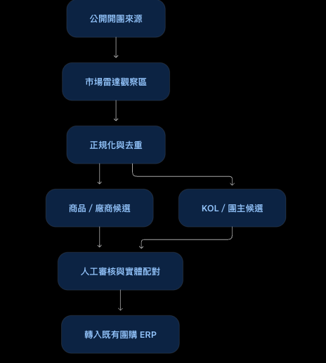

# Group Buying Market Radar — MVP Foundation

SDH 團購 ERP 的「團購市場情報與開發雷達」。Owner 已於 2026-11-04 重新定義 MVP：系統的第一個驗收閘門必須能實際發現市場上正在開團的商品；再由商品串出廠商公開資料、正在開團的 KOL／團主，以及可由開團人員加入與指派的預計開發名單。

> 本 Repository 與 `ws19135/group-buying-operations` 分離。ERP 仍是 Vendor、Product、Host、Campaign 的唯一真實來源（SoT）。

## 目前狀態

`MVP_STATUS=DISCOVERY_FOUNDATION`：v0.5 已完成公開來源治理與安全 Collector runtime，可在本機對逐站核准、不需登入的公開頁執行採集並保存 Evidence／Run／Audit。**目前 Repository 尚未登記真實網域，也尚未完成 30 筆真實開團事件 UAT，因此仍不符合完整 MVP 出場條件。**

| 能力 | 狀態 |
|---|---|
| 真實發現市場上正在開團的商品 | In progress：Collector 已完成；真實來源 UAT 尚未執行 |
| 以商品彙整所有開團 KOL／團主 | Not implemented |
| 自動補充廠商公開資料與證據 | Not implemented |
| 加入、指派及追蹤預計開發名單 | Not implemented |
| Observation／Evidence／去重／評分 | Implemented |
| 人工審核、Audit、Promotion Dry-run | Implemented |
| 六套角色工作台 | Implemented |

## 兩種執行模式

| 模式 | 用途 | 寫入範圍 |
|---|---|---|
| GitHub Pages 公開預覽 | 免登入展示六套角色工作台與合成資料 | 完全唯讀，沒有 API、資料庫或秘密 |
| 本機流程基礎版 | 已完成流程的操作與 UAT | 只寫入本機 SQLite；ERP 僅讀取 fixture 並執行 Dry-run |

公開預覽：<https://ws19135.github.io/group-buying-market-radar/>

## 已完成的流程基礎

- 人工公開 URL 建立 Observation，以及 CSV／JSON 批次匯入
- URL、handle、Email、日期與金額正規化；匯入與 Observation 冪等控制
- Evidence 證據鏈與 Match Candidate；只靠同名永遠不會自動合併
- Vendor／KOL 版本化評分；缺值標示 `UNKNOWN`，不偽造為 0
- OPS_EDITOR 提交；OPS_MANAGER／SYSTEM_ADMIN 核准、退回或忽略
- 核准後建立 Promotion Draft，並對 ERP 合成快照執行 Dry-run
- Request ID、前後狀態與 actor role 稽核紀錄；沒有 hard delete API
- 同一前端自動辨識「公開唯讀」或「本機 Sandbox」模式
- 六種角色各有專屬首頁、側邊選單、工作焦點、指標與色彩識別
- SYSTEM_ADMIN／OPS_MANAGER／OPS_EDITOR 呈現不同內部作業流程；FINANCE／VENDOR／HOST 為專屬唯讀視角
- 公開來源治理：政策、條款、公開性、負責人、頻率與 robots 狀態
- 安全公開頁 Collector：DNS／SSRF、robots.txt、redirect、timeout、retry 與 1 MB 上限
- Schema.org Product／Event 與 Open Graph fallback 解析；低信心候選強制人工確認
- Collector Run 保存目標 URL、parser version、content hash、計數與錯誤；可冪等重播

## 資料流程



## 本機啟動

需求：Node.js 22 以上（使用內建 `node:sqlite`，不需安裝第三方套件）。

```bash
npm run check
npm start
```

開啟 <http://localhost:4173>。首次啟動會建立 `.data/market-radar.sqlite` 並載入合成示範資料。可用 query string 指定角色：

```text
http://localhost:4173/?role=OPS_EDITOR#observations
```

可用環境變數：

| 變數 | 預設 | 說明 |
|---|---|---|
| `PORT` | `4173` | HTTP port |
| `HOST` | `127.0.0.1` | bind host |
| `MR_DATABASE_FILE` | `.data/market-radar.sqlite` | SQLite 路徑；測試可用 `:memory:` |
| `MR_SEED_DEMO` | `true` | 是否載入合成資料 |
| `MR_SANDBOX_WRITE_ENABLED` | `true` | 設為 `false` 可停用所有 API mutation |

## 安全邊界

- 公開 Pages 不包含登入、Cookie Session、ERP Token、SQLite 或寫入 API。
- Sandbox 的 `x-role` 僅供本機 UAT 模擬，不是正式身份驗證。
- 只有逐站核准的公開來源可由本機 Collector 擷取；登入後、LINE 群、私人社團與封閉資料固定禁止。
- 每次採集都會檢查 DNS 公網位址、robots.txt、同網域 redirect、timeout、頻率與 1 MB 回應上限。
- ERP 整合固定為 `DRY_RUN`，回傳 `production_touched: false` 與 `erp_write_enabled: false`。
- 正式上線前仍需 SSO／Session、後端身份映射、秘密管理、正式 ERP 唯讀 adapter、備份與監控。

## 文件

- [Owner 需求與 MVP 重新定義](docs/MVP_REBASELINE.md)
- [完整建置步驟](docs/IMPLEMENTATION_PLAN.md)
- [公開來源 Allowlist 與治理規則](docs/SOURCE_ALLOWLIST.md)
- [Milestone 2 首批公開來源候選](docs/SOURCE_CANDIDATES.md)
- [Collector 契約](docs/COLLECTOR_CONTRACT.md)
- [SRS 與驗收狀態](docs/SRS.md)
- [系統架構](docs/SAD.md)
- [詳細設計](docs/SDD.md)
- [API 契約](docs/API.md)
- [資料字典](docs/DATA_DICTIONARY.md)
- [需求追溯矩陣](docs/RTM.md)
- [UAT 計畫](docs/UAT_PLAN.md)
- [同事展示指南](docs/COLLEAGUE_DEMO_GUIDE.md)
- [ERP 整合契約](docs/INTEGRATION_CONTRACT.md)

## 測試

```bash
npm test
```

測試涵蓋六套角色體驗與導覽隔離、權限矩陣、公開來源治理、robots.txt、DNS／SSRF、HTML／JSON-LD 解析、回應限制、CSV、去重、UNKNOWN 評分、Collector Run 冪等、稽核、Promotion Dry-run 與禁止 hard delete。

## 授權

MIT
