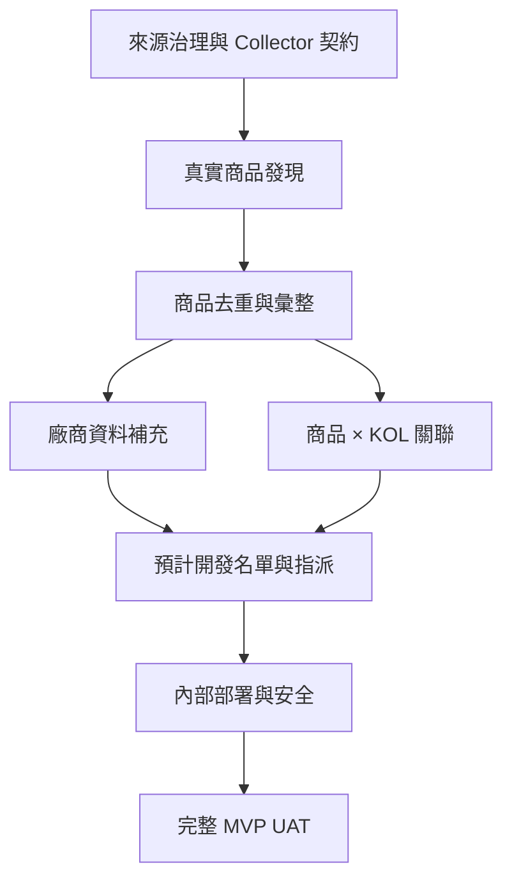

# 真實市場發現 MVP 建置步驟

版本：v1.0  
建立日期：2026-11-04  
依據：[MVP_REBASELINE.md](MVP_REBASELINE.md)

## Milestone 0 — 需求重設與誠實標示

狀態：Done

- 將目前版本改標示為 `MVP_STATUS=FOUNDATION`。
- 在 README、SRS、SAD、SDD、RTM、UAT 與公開畫面寫明真實採集尚未完成。
- 保留既有流程實作與測試，不把合成資料當成真實市場結果。

## Milestone 1 — 公開來源治理與 Collector 契約

狀態：Done（2026-11-04）

1. 建立首批 Source Allowlist，逐一記錄來源類型、公開性、robots／條款檢查結果、擷取頻率與 Owner。
2. 首批建議來源類型：公開品牌活動頁／公開團購頁、公開團購日曆或列表、開放網頁搜尋結果；不碰登入後內容。
3. 定義 Collector 介面：`discover() → fetch() → parse() → emit observations`。
4. 每次 run 保存 source、query、started_at、completed_at、parser_version、成功／重複／錯誤計數。
5. 加入 rate limit、timeout、retry、User-Agent、1 MB response limit 與 allowlist／SSRF 防護。

交付物：`SOURCE_ALLOWLIST.md`、`COLLECTOR_CONTRACT.md`、公開頁 Collector、fixture contract tests、來源治理 UI／API、Run metadata 與 Audit。

Owner Gate A：已通過。Owner 核准公開品牌／團購頁、公開清單／日曆與公開搜尋結果；明確排除 LINE 群、私人社團、登入後與封閉資料。

## Milestone 2 — 真實開團商品發現

狀態：Done（2026-11-05）

1. 已實作並驗證兩種真實來源 Adapter：BabyBuyRadar upcoming 與 NickJufu calendar。
2. 擷取商品名稱、品牌、公開價格、團期、開團狀態、來源 URL、平台與觀察時間。
3. 建立 `GroupBuyEvent`；同頁重新觀察時新增狀態歷程，不覆寫舊 Evidence。
4. 支援人工執行與排程執行；相同 run key 可安全重播。
5. 建立「市場發現 Feed」，顯示最新、進行中、即將結束、資料不足與來源異常。

交付物：真實 Discovery Worker、2 個 Adapters、Run dashboard、Market Discovery Feed、151 筆 UAT 資料。

Gate B：Passed。30 筆人工抽樣 30／30 正確（100%）；全部事件皆保留公開來源回鏈。詳見 [M2_UAT_EVIDENCE.md](M2_UAT_EVIDENCE.md)。

## Milestone 3 — 商品中心與跨來源去重

狀態：Planned

1. 新增 `ProductCandidate`、`ProductAlias`、`GroupBuyEvent`。
2. 以品牌、型號／規格、官方 URL、條碼等穩定證據建立 match candidate。
3. 名稱相似只能產生待確認候選，不自動合併。
4. 商品詳情頁彙整所有來源、價格區間、團期與開團 KOL。
5. 保存 merge／split 的人工決策與完整稽核。

Gate C：同商品跨 KOL／跨來源可正確彙整，錯誤合併率為 0。

## Milestone 4 — 廠商公開資料補充

狀態：Planned

1. 從商品與來源建立 `VendorCandidate`。
2. 補充公開商務資料：正式／顯示名稱、官網、公開合作頁、公開商務 Email、品類、地區與社群網址。
3. 每個欄位保存 source URL、captured_at、confidence 與 parser version。
4. 對既有 ERP Vendor 執行唯讀比對；只依同名不得連結。
5. 顯示缺值與證據充分度，不推測統編、營收或私人聯絡方式。

Gate D：從任何商品可追到廠商候選及其 Evidence。

## Milestone 5 — 商品 × KOL／團主關聯

狀態：Planned

1. 新增 `KolCandidate` 與 `KolProductRelation`。
2. 每筆關聯保存平台、handle、來源 URL、團期、首次／最後觀察時間與狀態。
3. 商品詳情列出「目前有哪些 KOL 在開團」；KOL 詳情列出歷史公開開團商品。
4. 同一 KOL 跨平台只建立 match candidate，未確認前不可自動合併。
5. 不蒐集登入後粉絲數、私人互動、轉換率或 GMV。

Gate E：同一商品可列出多位 KOL，且每一筆關聯都能回到公開證據。

## Milestone 6 — 預計開發名單與指派

狀態：Planned

1. 新增 `DevelopmentProspect`、`Assignment`、`DevelopmentActivity`。
2. OPS_EDITOR 可從 VendorCandidate 點選「加入預計開發名單」。
3. OPS_MANAGER 可設定負責開團人員、優先序與下一步日期。
4. 開發階段：`PLANNED → ASSIGNED → CONTACTED → RESPONDED → NEGOTIATING → WON／LOST／DO_NOT_CONTACT`。
5. 同一 Vendor 只能有一筆有效 Prospect；重複加入須回傳既有項目。
6. 所有指派、備註與狀態變更寫入 Audit；MVP 不自動發信或私訊。

Gate F：開團人員能看到自己的預計開發清單與下一步，主管能看到整體 Pipeline。

## Milestone 7 — 內部部署、排程與安全

狀態：Planned

- 將真實資料與開發名單部署於受控後端／資料庫；GitHub Pages 只保留合成展示。
- 導入 SSO／Session 與後端 role mapping，移除正式環境的 `x-role` 模擬。
- Secrets 只能存於受管 Secrets，不進 repo、前端或 log。
- 建立排程、失敗告警、備份、資料保留與刪除政策。
- 建立 Collector kill switch、來源級停用與全域停用。

Gate G：安全檢查、備份還原與最小權限 UAT 通過。

## Milestone 8 — 完整 MVP UAT 與交付

狀態：Planned

- 使用至少 30 筆真實公開開團事件完成端到端 UAT。
- 驗證商品 → 廠商 → KOL → 開發名單 → 指派 → 審核 → Dry-run。
- 驗證重跑冪等、錯誤恢復、來源停用、UNKNOWN、權限與 Audit。
- 更新 `SANDBOX_EVIDENCE.md`、`RTM.md`、`HANDOFF.md` 與同事展示指南。
- 全部 Gate 通過後，才把健康狀態改為 `MVP_COMPLETE`。

## 建置順序摘要

