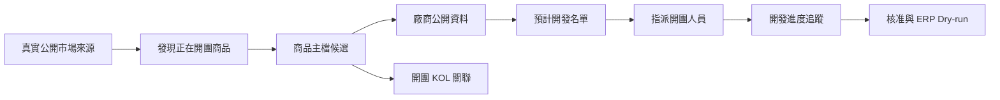

# Market Radar MVP 重新定義與 Owner 決策

決策日期：2026-11-04  
狀態：Approved by Owner／Rebaselined  
目前實作：Foundation only

## 1. Owner 原始需求紀錄

本系統的 MVP 不只是把人工輸入的資料進行整理。MVP 的第一步必須能夠：

1. 實際找到市場上現在正在開團的商品。
2. 找到商品後，進一步收集該商品廠商的公開資料。
3. 讓公司開團人員把適合的廠商加入「預計開發名單」。
4. 同一商品頁必須看得到目前有哪些 KOL／團主正在開這項商品的團。

因此，現有 Observation、去重、評分、審核與 ERP Dry-run 是後續處理基礎，不是完整 MVP 的起點驗收。

## 2. 正式 MVP 目標流程

## 3. 新增決策 D-MR-11～20

| ID | 決策 |
|---|---|
| D-MR-11 | 真實公開市場發現是 MVP 第一個驗收閘門；只有人工輸入或合成資料不算完成。 |
| D-MR-12 | Product 是主要聚合中心；一個 Product 可對應多筆 GroupBuyEvent。 |
| D-MR-13 | 每筆 GroupBuyEvent 必須連結公開來源、觀察時間、開團狀態，以及可辨識時的 Vendor 與 KOL。 |
| D-MR-14 | 同一商品必須彙整所有已觀察到的 KOL／團主，不把每個 KOL 開團誤當成不同商品。 |
| D-MR-15 | 廠商資料只收集公開商務資訊，且每個欄位必須保留 Evidence 與 captured_at。 |
| D-MR-16 | 開團人員可把 VendorCandidate 加入 DevelopmentProspect，設定 Owner、優先序、狀態與下一步日期。 |
| D-MR-17 | 系統不得自動聯絡廠商或 KOL；對外聯絡必須由人員明確執行。 |
| D-MR-18 | 登入後、私人社團、私人 LINE、非公開後台與規避平台限制的資料不在採集範圍。 |
| D-MR-19 | Collector、Parser、Normalization 與 Match 規則皆須版本化、冪等且可重跑。 |
| D-MR-20 | 公開 GitHub Pages 只做合成資料展示；真實採集、內部名單與聯絡資料必須在受控後端。 |

## 4. 完整 MVP 出場條件

以下條件全部成立，才能將狀態由 `FOUNDATION` 改為 `MVP_COMPLETE`：

- 至少兩種經政策審查的公開來源類型可自動或一鍵執行採集。
- UAT 能發現至少 30 筆可公開驗證的近期／進行中開團事件。
- 每筆事件具有 source URL、observed_at、Evidence 與開團狀態；未知值保持 `UNKNOWN`。
- 商品去重後，商品詳情頁可列出所有已發現的開團 KOL／團主。
- 可從商品追到 VendorCandidate，並顯示有證據的廠商官網、公開合作方式與品類。
- OPS_EDITOR／OPS_MANAGER 可把廠商加入預計開發名單、指派負責人並更新開發階段。
- 重跑相同採集批次不會重複建立商品、開團事件或開發名單。
- 所有新增、指派與狀態變更都有 Audit Log。
- 公開 Pages 不出現真實內部開發名單、秘密或寫入 API。
- 正式 ERP 維持不寫入，Promotion 仍只到 Dry-run。

## 5. 當前差距

目前已有 Observation、Evidence、來源登錄、人工／CSV／JSON 匯入、線索評分、人工審核、角色工作台、Audit 與 Dry-run。尚缺真實 Discovery Worker、公開來源 Adapters、Product／GroupBuyEvent 關聯模型、Vendor Enrichment 與 Development Pipeline。

