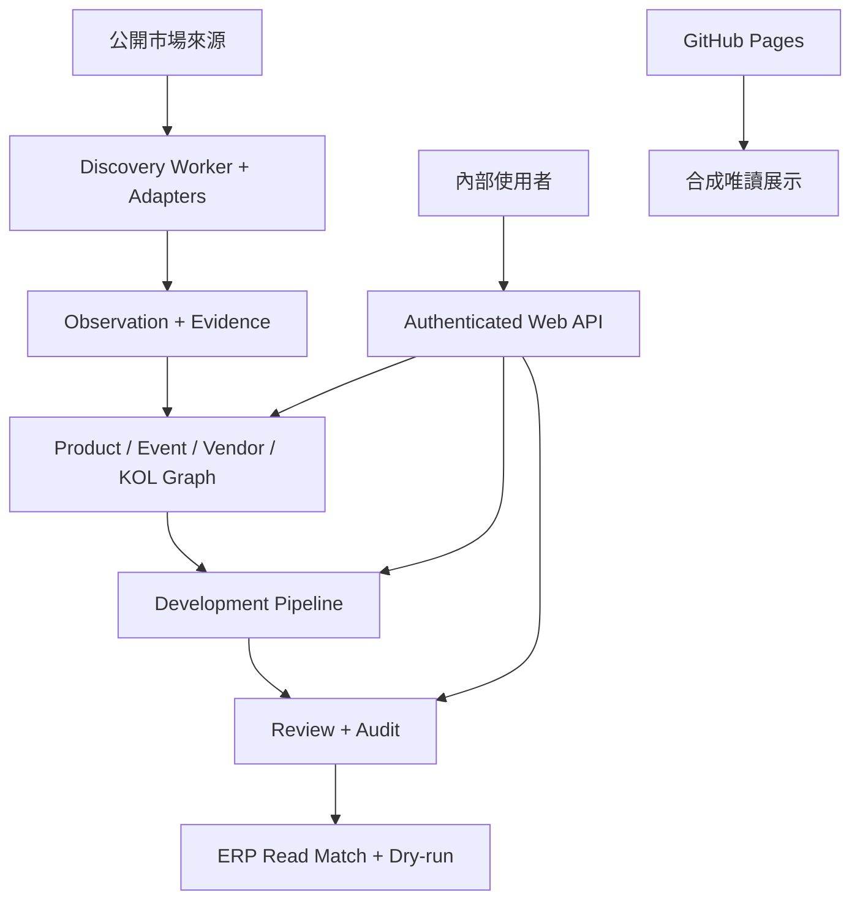

# 系統架構文件（SAD）v0.4

狀態：Discovery Foundation Implemented／Product Graph Planned
日期：2026-11-04

## 1. 架構決策

Market Radar 採「公開合成展示＋受控內部系統」。公開 GitHub Pages 是免登入、無秘密、無後端的唯讀展示；真實市場採集、廠商補充與開發名單必須在受控後端執行。既有 `group-buying-operations` 不被修改，且仍是正式主檔 SoT。

## 2. 元件

| 元件 | 職責 | 邊界 |
|---|---|---|
| `index.html`／`app.js` | 八頁 UI、角色預覽、表單與雙模式切換 | 不保存秘密 |
| `api-client.js` | 健康探測、REST 呼叫、request ID 與 Sandbox role | Pages 探測失敗即退回唯讀 |
| `server.mjs` | 同源 HTTP、RBAC、輸入上限、安全標頭、靜態檔 | 不提供 ERP write endpoint |
| `src/domain.mjs` | 正規化、fingerprint、去重候選、評分、CSV、Dry-run | 純領域邏輯，可重現 |
| `src/database.mjs` | SQLite migration、交易、稽核與查詢 | 資料只在 `.data/` |
| `src/collector.mjs` | 來源治理驗證、robots、安全 fetch、公開頁解析 | 只處理逐站核准且不需登入的公開頁 |
| `fixtures/erp-master-snapshot.json` | 合成 ERP 唯讀快照 | 不含真實主檔或個資 |
| Discovery Worker | 手動執行公開來源採集、Run／Audit | Manual runtime implemented；排程 Planned |
| Public Page Adapter | Schema.org Product／Event、Open Graph fallback | Implemented；真實來源 UAT Pending |
| Search／Listing Adapter | 公開搜尋結果或清單發現 | Planned；逐來源政策審查 |
| Product Graph | Product、GroupBuyEvent、Vendor、KOL 關聯 | Planned |
| Development Pipeline | 預計開發名單、指派、階段與下一步 | Planned；內部資料 |

## 3. 信任邊界

1. 瀏覽器輸入屬不可信資料；API 驗證格式、大小、URL 與角色能力。
2. `x-role` 只供 Sandbox UAT，不視為正式身份；正式環境須由 SSO session 映射角色。
3. SQLite 與 fixture 都在 Sandbox 邊界；公開 Pages 不部署執行後端。
4. Promotion 僅產生 `DRY_RUN`，結果固定 `would_update: false`，沒有正式 ERP mutation。
5. 公開來源是外部不可信輸入；Collector 必須執行 Allowlist、SSRF、大小、timeout、rate limit 與內容型別驗證。
6. 真實開發名單不得部署到 Pages；正式身份須由 SSO／Session 映射，不可使用可偽造的 `x-role`。

## 4. 部署

- 公開：GitHub Actions 執行 `npm run check`，成功後部署 repository 靜態內容至 Pages。
- Discovery Sandbox：Node.js 22+ 執行 `node server.mjs`，SQLite 自動 migration／seed；核准來源可由管理員手動採集。
- 完整 MVP：需要可執行排程 Worker 的受控 runtime 與受管資料庫；排程與正式身份屬 Milestone 7。
- 正式化前：需受管資料庫、SSO、秘密管理、備份、監控、正式 ERP 唯讀 adapter 與 Owner 核准閘門。

## 5. 可用性與復原

- Observation 與 import 皆以 fingerprint／idempotency key 防止重送。
- 每次 mutation 使用 SQLite transaction，審核與 promotion 事件寫入 audit log。
- API 不提供 hard delete；資料修正以新 Observation 或 review decision 表達。
- 資料庫檔可在停機狀態備份；MVP 不宣稱多節點或高可用。

