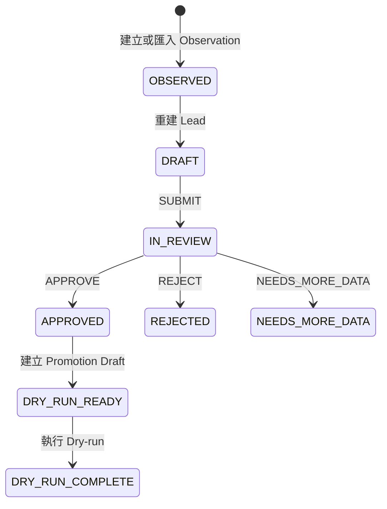

# 詳細設計文件（SDD）v0.2

## 1. 核心流程

## 2. Observation

- 輸入先驗證公開 HTTP(S) URL，再進行 NFKC、空白、handle、Email、日期、金額與追蹤參數正規化。
- fingerprint 使用 canonical URL、entity type、handle、名稱 key 與開始時間的穩定 JSON SHA-256。
- 重複 fingerprint 回傳既有資料，不新增第二筆。
- 每個已知欄位建立 Evidence；原始 payload、hash、parser／normalization version 均保存。

## 3. Import

- 支援 JSON array、`{ records: [] }` 與含引號 CSV。
- `idempotency_key` 已存在時回傳 replay，不重做。
- 每列獨立處理；結果可為 `COMPLETED`、`PARTIAL` 或 `FAILED`，錯誤保留 row、code、message。
- request body 上限 1 MB。

## 4. 去重與評分

穩定識別（同 canonical URL、公開 Email、同平台 handle）只產生人工審核候選。只依 display name 的候選 confidence 為 0.45 並標記 `NAME_ONLY_MATCH_NOT_ALLOWED`，永不自動合併。

Vendor 權重：25／20／20／20／10／5；KOL 權重：30／20／15／15／10／10。未知維度的 points 為 `null` 且 status 為 `UNKNOWN`；總分不假裝未知值為實測 0，並另顯示 `data_sufficiency`。

## 5. RBAC

| 能力 | ADMIN | MANAGER | EDITOR | FINANCE／VENDOR／HOST |
|---|---:|---:|---:|---:|
| view | ✓ | ✓ | ✓ | ✓ |
| review／建立 Observation／匯入 | ✓ | ✓ | ✓ | — |
| approve | ✓ | ✓ | — | — |
| source_admin | ✓ | — | — | — |
| integration_dry_run | ✓ | ✓ | — | — |

所有 mutation 先檢查 Sandbox 全域寫入開關，再檢查角色能力。公開 Pages 沒有 API，因此 UI mutation 一律 disabled。

## 6. Promotion Dry-run

只有 `APPROVED` lead 可建立 draft。系統以公開 Email 或 website URL 對 fixture 做穩定配對；同名而無穩定 ID 時回傳 `CONFLICT`。可能結果為 `WOULD_CREATE`、`WOULD_LINK_EXISTING`、`CONFLICT` 或 `INCOMPLETE`，永遠不更新主檔。

## 7. 錯誤與稽核

API error schema：`{ error: { code, message }, request_id }`。伺服器錯誤不洩漏 stack。稽核保存 actor role、action、entity、before／after、request ID 與 timestamp。

